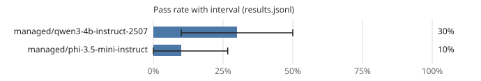

# Leaderboard: mini-general

- Results: [`results.jsonl`](results.jsonl) (60 runs, 15 tasks, seeds [0, 1])
- Command: `ssw bench run --suite mini-general --workers managed/qwen3-4b-instruct-2507,managed/phi-3.5-mini-instruct --seeds 2 --budget-seconds 900.0`
- Hardware: os Windows, arch x86_64, cpu_cores 32, ram_gb 1098.43, gpus 4, gpu_memory_gb [51.53, 48.31, 51.53, 51.53]
- Date: 2026-10-16T13:12:41+00:00
- Version: 0.1.0.dev0 (commit cd9ffff3f77c)
- Pass-rate intervals: 95%, cluster bootstrap over tasks (10,000 resamples, seed 0); Wilson score interval with one task.
- Scoring: a run passes when every acceptance command exits with 0 on a fresh copy with the run's diff applied and the suite's protected paths restored.

| Rank | Contestant | Pass rate | 95% interval | Runs | Median wall (s) | Median tokens | GPU-s | Escalations | Cache hits | Changed tests | Reference cost |
|---:|---|---:|---:|---:|---:|---:|---:|---:|---:|---:|---:|
| 1 | managed/qwen3-4b-instruct-2507 | 30% | 10% to 50% | 30 | 69.6 | 18,563 | 0.0 | 0% | 82% | 0 | - |
| 2 | managed/phi-3.5-mini-instruct | 10% | 0% to 27% | 30 | 451.2 | 42,674 | 0.0 | 0% | 89% | 0 | - |

