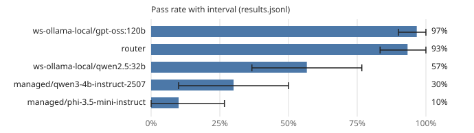

# Leaderboard: mini-general

- Results: [`results.jsonl`](results.jsonl) (150 runs, 15 tasks, seeds [0, 1])
- Command: `ssw bench report 2026-10-16-mini-general-gpu 2026-10-16-mini-general-gpt-oss 2026-10-16-mini-general-cpu 2026-10-16-mini-general-router --out 2026-10-16-mini-general`
- Hardware: os Windows, arch x86_64, cpu_cores 32, ram_gb 1098.43, gpus 4, gpu_memory_gb [51.53, 48.31, 51.53, 51.53]
- Date: 2026-10-16T13:12:41+00:00
- Version: 0.1.0.dev0
- Pass-rate intervals: 95%, cluster bootstrap over tasks (10,000 resamples, seed 0); Wilson score interval with one task.
- Scoring: a run passes when every acceptance command exits with 0 on a fresh copy with the run's diff applied and the suite's protected paths restored.
- Router pool: `ws-ollama-local/gpt-oss:120b`, `ws-ollama-local/qwen2.5:32b`
- Run `2026-10-16-mini-general-gpu`: `ssw bench run --suite mini-general --workers ws-ollama-local/qwen2.5:32b,ws-ollama-local/gpt-oss:120b --seeds 2 --budget-seconds 900.0`, 2026-10-16T08:23:35+00:00 to ?, commit cd9ffff3f77c (rescored under the scoring rule above)
- Run `2026-10-16-mini-general-gpt-oss`: `ssw bench run --suite mini-general --workers ws-ollama-local/gpt-oss:120b --seeds 2 --budget-seconds 900.0`, 2026-10-16T09:02:19+00:00 to 2026-10-16T09:33:09+00:00, commit cd9ffff3f77c (rescored under the scoring rule above)
- Run `2026-10-16-mini-general-cpu`: `ssw bench run --suite mini-general --workers managed/qwen3-4b-instruct-2507,managed/phi-3.5-mini-instruct --seeds 2 --budget-seconds 900.0`, 2026-10-16T08:23:36+00:00 to 2026-10-16T13:12:41+00:00, commit cd9ffff3f77c (rescored under the scoring rule above)
- Run `2026-10-16-mini-general-router`: `ssw bench run --suite mini-general --workers router --seeds 2 --router-pool ws-ollama-local/qwen2.5:32b,ws-ollama-local/gpt-oss:120b --budget-seconds 900.0`, 2026-10-16T10:33:16+00:00 to 2026-10-16T11:01:15+00:00, commit 4766b7969e9a

| Rank | Contestant | Pass rate | 95% interval | Runs | Median wall (s) | Median tokens | GPU-s | Escalations | Cache hits | Changed tests | Reference cost |
|---:|---|---:|---:|---:|---:|---:|---:|---:|---:|---:|---:|
| 1 | ws-ollama-local/gpt-oss:120b | 97% | 90% to 100% | 30 | 57.8 | 36,202 | 1,511.3 | 0% | 80% | 0 | - |
| 2 | router | 93% | 83% to 100% | 30 | 49.2 | 35,392 | 1,343.7 | 0% | 83% | 0 | - |
| 3 | ws-ollama-local/qwen2.5:32b | 57% | 37% to 77% | 30 | 58.6 | 11,760 | 3,767.0 | 0% | 85% | 9 | - |
| 4 | managed/qwen3-4b-instruct-2507 | 30% | 10% to 50% | 30 | 69.6 | 18,563 | 0.0 | 0% | 82% | 0 | - |
| 5 | managed/phi-3.5-mini-instruct | 10% | 0% to 27% | 30 | 451.2 | 42,674 | 0.0 | 0% | 89% | 0 | - |

