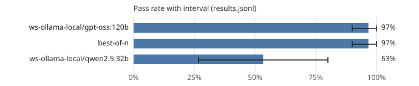

# Leaderboard: mini-general

- Results: [`results.jsonl`](results.jsonl) (90 runs, 15 tasks, seeds [0, 1])
- Command: `ssw bench run --suite mini-general --workers ws-ollama-local/gpt-oss:120b,ws-ollama-local/qwen2.5:32b,best-of-n --seeds 2 --router-pool ws-ollama-local/gpt-oss:120b,ws-ollama-local/qwen2.5:32b --best-of 2 --budget-seconds 900.0`
- Hardware: os Windows, arch x86_64, cpu_cores 32, ram_gb 1098.43, gpus 4, gpu_memory_gb [51.53, 48.31, 51.53, 51.53]
- Date: 2026-10-19T08:23:29+00:00
- Version: 0.1.0.dev0 (commit a27cce9d9d8c)
- Pass-rate intervals: 95%, cluster bootstrap over tasks (10,000 resamples, seed 0); Wilson score interval with one task.
- Scoring: a run passes when every acceptance command exits with 0 on a fresh copy with the run's diff applied and the suite's protected paths restored.
- Router pool: `ws-ollama-local/gpt-oss:120b`, `ws-ollama-local/qwen2.5:32b`

| Rank | Contestant | Pass rate | 95% interval | Runs | Median wall (s) | Median tokens | GPU-s | Escalations | Cache hits | Changed tests | Reference cost |
|---:|---|---:|---:|---:|---:|---:|---:|---:|---:|---:|---:|
| 1 | ws-ollama-local/gpt-oss:120b | 97% | 90% to 100% | 30 | 147.6 | 29,749 | 4,518.0 | 0% | 84% | 0 | - |
| 2 | best-of-n | 97% | 90% to 100% | 30 | 214.3 | 46,914 | 6,460.4 | 0% | 83% | 1 | - |
| 3 | ws-ollama-local/qwen2.5:32b | 53% | 27% to 80% | 30 | 81.7 | 11,981 | 2,490.9 | 0% | 78% | 11 | - |

