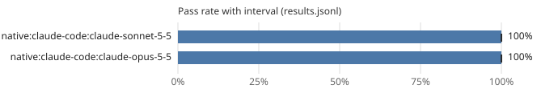

# Leaderboard: mini-general

- Results: [`results.jsonl`](results.jsonl) (60 runs, 15 tasks, seeds [0, 1])
- Command: `ssw bench run --suite mini-general --workers native:claude-code:claude-sonnet-5-5,native:claude-code:claude-opus-5-5 --seeds 2 --budget-seconds 900.0`
- Hardware: os Windows, arch x86_64, cpu_cores 32, ram_gb 1098.43, gpus 4, gpu_memory_gb [51.53, 48.31, 51.53, 51.53]
- Date: 2026-10-19T22:29:11+00:00
- Version: 0.1.0.dev0 (commit 4f7124801393)
- Pass-rate intervals: 95%, cluster bootstrap over tasks (10,000 resamples, seed 0); Wilson score interval with one task.
- Scoring: a run passes when every acceptance command exits with 0 on a fresh copy with the run's diff applied and the suite's protected paths restored.

| Rank | Contestant | Pass rate | 95% interval | Runs | Median wall (s) | Median tokens | Median uncached | Median hosted | GPU-s | Escalations | Cache hits | Changed tests | Reference cost |
|---:|---|---:|---:|---:|---:|---:|---:|---:|---:|---:|---:|---:|---:|
| 1 | native:claude-code:claude-sonnet-5-5 | 100% | 100% to 100% | 30 | 18.2 | 73,486 | 7,186 | 73,486 | 0.0 | 0% | 91% | 0 | - |
| 2 | native:claude-code:claude-opus-5-5 | 100% | 100% to 100% | 30 | 19.3 | 92,510 | 8,314 | 92,510 | 0.0 | 0% | 91% | 0 | - |

