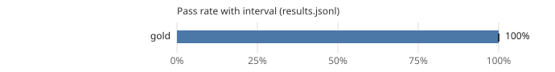

# Leaderboard: swebench-verified-mini

- Results: [`results.jsonl`](results.jsonl) (50 runs, 50 tasks, seeds [0])
- Command: `ssw bench run --suite swebench-verified-mini --workers gold --seeds 1`
- Hardware: not recorded
- Date: 2026-10-20T08:48:34+00:00
- Version: 0.1.0.dev0 (commit 7359b1589030)
- Pass-rate intervals: 95%, cluster bootstrap over tasks (10,000 resamples, seed 0); Wilson score interval with one task.
- Scoring: a run passes when the official harness (swebench 5.0.2) resolves the instance with the run's patch: every FAIL_TO_PASS test passes and every PASS_TO_PASS test still passes.

| Rank | Contestant | Pass rate | 95% interval | Runs | Median wall (s) | Median tokens | Median uncached | Median hosted | GPU-s | Escalations | Cache hits | Changed tests | Reference cost |
|---:|---|---:|---:|---:|---:|---:|---:|---:|---:|---:|---:|---:|---:|
| 1 | gold | 100% | 100% to 100% | 50 | 0.0 | 0 | 0 | 0 | 0.0 | 0% | - | 0 | - |

