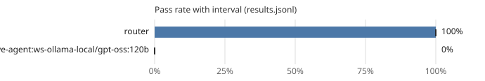

# Leaderboard: swebench-dev

- Results: [`results.jsonl`](results.jsonl) (4 runs, 2 tasks, seeds [0])
- Command: `ssw bench run --suite swebench-dev --workers router,mini-swe-agent:ws-ollama-local/gpt-oss:120b --seeds 1 --tasks sphinx-doc__sphinx-8459,django__django-12858 --router-pool ws-ollama-local/gpt-oss:120b --max-steps 100 --budget-seconds 3600.0`
- Hardware: not recorded
- Date: 2026-10-20T16:23:43+00:00
- Version: 0.1.0.dev0 (commit 8fd3b0773318)
- Pass-rate intervals: 95%, cluster bootstrap over tasks (10,000 resamples, seed 0); Wilson score interval with one task.
- Scoring: a run passes when the official harness (swebench 5.0.2) resolves the instance with the run's patch: every FAIL_TO_PASS test passes and every PASS_TO_PASS test still passes.
- Router pool: `ws-ollama-local/gpt-oss:120b`

| Rank | Contestant | Pass rate | 95% interval | Runs | Median wall (s) | Median tokens | Median uncached | Median hosted | GPU-s | Escalations | Cache hits | Changed tests | Reference cost |
|---:|---|---:|---:|---:|---:|---:|---:|---:|---:|---:|---:|---:|---:|
| 1 | router | 100% | 100% to 100% | 2 | 629.6 | 1,924,836 | 149,110 | 0 | 0.0 | 0% | 93% | 1 | - |
| 2 | mini-swe-agent:ws-ollama-local/gpt-oss:120b | 0% | 0% to 0% | 2 | 1,433.4 | 388,199 | 67,084 | 0 | 0.0 | 0% | 96% | 0 | - |

